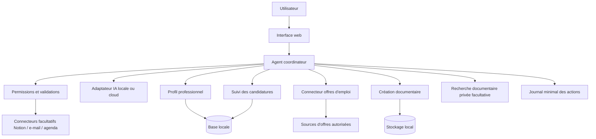

# Architecture envisagée

[Français](architecture.fr.md) · [English](architecture.md)

> Proposition d'architecture uniquement. Aucun agent opérationnel ni intégration fonctionnelle n'est revendiqué.

## Principes
- **Hybride et données personnelles maîtrisées :** Ollama local ou API cloud, fichiers locaux ou cloud personnel, deux choix indépendants.
- **Séparation du VPS :** hébergement possible de la web app et d'API sans conservation durable des dossiers professionnels ; certaines requêtes peuvent transiter par le serveur.
- **Référence :** voir [architecture hybride](hybrid-architecture.fr.md) pour les limites des navigateurs, la gestion des identifiants et les fichiers Markdown.
- **Contrôle humain :** les consultations peuvent être automatisées ; l'envoi, le partage et toute modification importante nécessitent une validation explicite.
- **Modularité :** adaptateurs remplaçables pour les offres, documents et outils de productivité.
- **Traçabilité :** provenance des informations, actions et validations, en limitant les données journalisées.
- **Accessibilité :** un seul modèle local au départ ; les agents spécialisés sont des rôles logiques, pas forcément plusieurs LLM chargés en mémoire.

## Schéma logique

## Boucle agentique
1. Recevoir un objectif et les contraintes fixées par l'utilisateur.
2. Construire un plan borné (étapes, temps et appels d'outils limités).
3. Choisir un outil autorisé et valider les paramètres.
4. Exécuter, analyser le résultat et indiquer la source des informations.
5. S'arrêter, demander une autorisation ou continuer dans les limites définies.
6. Présenter les actions réalisées, les incertitudes et les suites proposées.

## Frontières des données
Les documents personnels, le parcours professionnel, les offres enregistrées et les brouillons sont conservés dans le stockage choisi par l'utilisateur (local ou cloud personnel autorisé). Les recherches externes peuvent divulguer des termes de requête : elles devront éviter les détails personnels inutiles. Les intégrations distantes resteront facultatives, limitées et révocables.

## Choix techniques à étudier
Python, FastAPI, Ollama avec un modèle quantifié, SQLite pour un prototype, python-docx et LibreOffice, Docker Compose si utile. Le RAG et une base vectorielle restent optionnels. La plateforme ASUS RTX 5060 Ti 16 Go est une référence matérielle envisagée, **pas une configuration testée**.

## Points à valider
Exactitude des réponses, fiabilité des sources et autorisations d'accès aux offres, ressources GPU, injection de consignes via des annonces, permissions des outils, confidentialité et qualité des exports.
