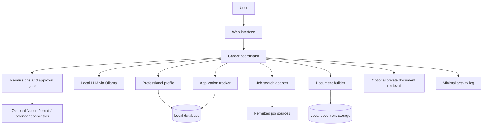

# Proposed architecture

[Français](architecture.fr.md) · [English](architecture.md)

> Design proposal only. No running agent or integrated application is claimed.

## Design principles
- **Local-first:** local LLM inference and private data by default.
- **Human control:** read-only operations may be automated; sending, sharing, publishing and material changes require explicit approval.
- **Modular:** adapters for job sources, document editors and personal productivity services are replaceable.
- **Traceable:** every sourced fact, tool call, recommendation and approval is recorded with minimal necessary detail.
- **Accessible:** one modest local model at first; specialized roles are logical workflows, not necessarily separately loaded LLMs.

## Logical architecture

## Agent loop
1. Receive a user goal and explicit constraints.
2. Form a bounded plan (maximum number of steps, time and tool calls).
3. Select an authorized tool and validate its arguments.
4. Run it, inspect the result, and cite its source when relevant.
5. Stop, ask for approval, or continue until the goal is met or a limit is reached.
6. Show the user actions taken, uncertain facts and suggested next steps.

## Data boundaries
Personal files, structured professional history, saved offers and generated drafts remain in local storage by default. External searches may reveal search terms, so requests should omit unnecessary personal details. Remote integrations should be optional, scoped and revocable.

## Candidate technology, not a final decision
Python; FastAPI; Ollama with a quantized open-weight model; SQLite for early prototypes; python-docx and LibreOffice for document output; Docker Compose if useful. RAG and a vector store are optional, not prerequisites. The proposed ASUS RTX 5060 Ti 16 GB platform is a hardware reference, **not a tested configuration**.

## Risks to validate
Model accuracy and unsupported inferences, job-source terms and availability, resource use on 16 GB VRAM, prompt injection from job ads, unsafe tool permissions, privacy and export quality.
