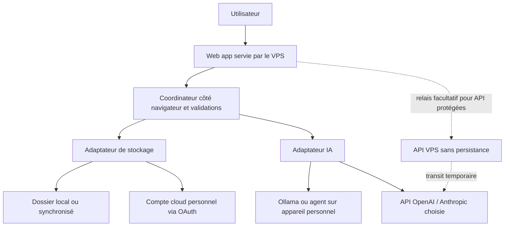

# Architecture hybride et données appartenant à l'utilisateur

[Français](hybrid-architecture.fr.md) · [English](hybrid-architecture.md)

> **Concept / étude de conception — non implémenté.** Ce document décrit une cible et ses limites techniques, pas des intégrations opérationnelles.

## Nouvelle orientation

ReStart AI devient **hybride, indépendant des fournisseurs et fondé sur la propriété des données par l'utilisateur**. Chaque personne choisit séparément (1) le stockage de ses données et (2) le moteur d'IA. Un GPU personnel ou un abonnement API ne seront pas imposés à tous les usages ; chaque option aura ses contraintes.

### Deux choix indépendants

**Moteur d'IA**
- Local : Ollama ou autre serveur d'inférence compatible, éventuellement associé à un agent local.
- Cloud : API choisie par l'utilisateur, notamment OpenAI ou Anthropic, avec son propre compte, sa facturation et ses conditions de traitement des données.
- Hybride : sélection du moteur selon les tâches. Un agent distant pourra être intégré via un adaptateur de capacités et de permissions ; une API de LLM seule n'est pas automatiquement un agent autonome.

**Stockage**
- Local : dossier choisi par l'utilisateur, avec fichiers Markdown et pièces jointes.
- Dossier synchronisé : dossier géré par les clients iCloud Drive, OneDrive, Dropbox, Google Drive ou équivalent ; l'accès dépend du navigateur et du système.
- Cloud direct : connexion autorisée par l'utilisateur aux API Google Drive, Microsoft Graph OneDrive ou Dropbox.
- À étudier : WebDAV ou stockage compatible S3 appartenant à l'utilisateur.

Ces options sont combinables : **dossier local + API Anthropic**, **OneDrive + Ollama local**, **Dropbox + API OpenAI**, etc.

## Rôle du VPS et frontières de confiance

Un VPS public peut héberger :
- Le front-end web et ses ressources statiques.
- Une API Python pour de l'orchestration *sans persistance*, la découverte des capacités et, si nécessaire, un relais sécurisé.
- **Aucune base de données durable de CV, candidatures, entretiens ou profils d'utilisateurs.**

**Nuance indispensable :** si une demande passe par le serveur, ses données transitent dans le processus serveur. « Pas de stockage sur le VPS » ne signifie pas « le VPS ne voit jamais les données » ni « chiffrement de bout en bout ». Un appel vers un LLM cloud transmet également le contexte nécessaire au fournisseur choisi. Les logs, proxy inverse, systèmes d'erreur et caches ne devront pas enregistrer ces contenus.

Un VPS ne peut pas manipuler directement un dossier de l'ordinateur de l'utilisateur à partir d'une simple requête web. Si le navigateur est fermé, une architecture exclusivement navigateur ne peut pas garantir des recherches planifiées : une application compagnon locale ou une infrastructure distante autorisée serait nécessaire.

### Flux logique envisagé



L'orchestration côté navigateur est à privilégier pour les opérations accédant aux données personnelles. Un relais côté serveur peut être envisagé de façon facultative et transparente, sans accès arbitraire aux dossiers locaux. Une application compagnon installée sur l'ordinateur serait à étudier pour améliorer la compatibilité entre navigateurs, les connexions aux LLM locaux et les tâches en arrière-plan.

## Contraintes connues

- **Dossier local :** l'API `showDirectoryPicker` requiert HTTPS, une action volontaire et une autorisation ; son support varie selon les navigateurs. Prévoir import/export ou compagnon local.
- **iCloud Drive :** ce n'est pas une API REST de fichiers universelle accessible à une web app. Un dossier local synchronisé via iCloud peut convenir si le navigateur et l'OS le permettent ; une application native serait plus robuste. Ne pas promettre un accès web direct généralisé.
- **Google Drive :** un dossier classique visible convient mieux aux fichiers Markdown personnels qu'un `appDataFolder` masqué.
- **OneDrive / Dropbox :** possibilité de dossiers d'application à autorisations limitées ; valider les contraintes selon le compte et les API.
- **IA locale :** connexion depuis une page HTTPS vers localhost ou le réseau local à sécuriser et tester (CORS, contenus mixtes, autorisations réseau, authentification et risques CSRF/SSRF). Ne pas exposer Ollama directement sur Internet.
- **IA cloud :** exposer une clé API dans le navigateur présente des risques. Étudier un compagnon local, des identifiants de courte durée lorsqu'ils existent ou un relais sans persistance avec permissions limitées. Protéger le relais contre les abus.
- **Tâches planifiées :** une web app fermée ne continue pas nécessairement à travailler. Un compagnon local ou un planificateur distant, avec consentement et permissions limitées, seraient des évolutions distinctes.

## Stockage Markdown en priorité

Un **fichier Markdown par profil, offre, candidature et note**, avec des métadonnées YAML en tête de fichier. Les pièces jointes et documents exportés sont placés à part. Schéma indicatif non stabilisé :

```text
ReStartAI/
  profile/
    master-profile.md
  opportunities/
    job-example-001.md
  applications/
    application-example-001.md
  notes/
    career-plan.md
  attachments/
  exports/
```

Exemple fictif :

```markdown
---
schema_version: 1
id: app-demo-001
type: application
job_ref: job-example-001
status: draft
created_at: 2026-11-07T00:00:00Z
updated_at: 2026-11-07T00:00:00Z
---

# Notes de candidature

Documents en attente de validation. Aucune candidature envoyée.
```

L'utilisateur doit pouvoir lire et modifier ses fichiers sans ReStart AI. Un adaptateur commun devra assurer lecture, écriture, inventaire et gestion des versions ; il faudra prévoir les conflits de synchronisation, les sauvegardes et si possible les écritures atomiques. Le Markdown serait la source de vérité, avec un index local facultatif et reconstructible. Aucun secret ni jeton d'accès ne doit être placé dans ces fichiers.

## Contrat de confidentialité et de sécurité

1. Afficher séparément le **stockage actif** et le **fournisseur IA actif**.
2. Expliquer quelles données transitent par chaque acteur et les durées possibles de conservation.
3. Pas de transmission externe inutile sans autorisation.
4. Validation spécifique avant envoi d'e-mails, dépôt de candidatures, partage ou modification sensible.
5. OAuth avec Authorization Code + PKCE pour les applications navigateur quand disponible, permissions minimales et révocables.
6. Traiter annonces, documents et résultats IA comme des données non fiables ; vérifier les actions agentiques.
7. Éviter toute conservation de CV, prompts, tokens et codes OAuth dans les journaux du VPS.
8. Prévoir portabilité, suppression, retrait des autorisations et éventuellement chiffrement côté client, avec explication de ses limites.
9. Ne pas promettre l'absence de conservation chez les fournisseurs : les politiques OpenAI et Anthropic dépendent des services et paramètres.

## Étapes de validation technique

1. Tester la lecture/écriture Markdown dans un navigateur Chromium compatible et l'import/export de secours dans Safari/Firefox.
2. Tester un connecteur cloud avec OAuth et permissions réduites.
3. Prototyper un adaptateur Ollama et un adaptateur IA cloud sur des données fictives.
4. Vérifier précisément les données transitant par le navigateur, le VPS et les fournisseurs ; auditer les logs.
5. Tester les conflits de fichiers entre deux appareils.
6. Documenter le comportement hors ligne et les limites des tâches planifiées.

## Documentation de référence
- [MDN : showDirectoryPicker](https://developer.mozilla.org/en-US/docs/Web/API/Window/showDirectoryPicker)
- [Google Drive : appDataFolder](https://developers.google.com/workspace/drive/api/guides/appdata)
- [Microsoft Graph : dossier applicatif OneDrive](https://learn.microsoft.com/en-us/graph/onedrive-sharepoint-appfolder)
- [Dropbox : dossiers applicatifs](https://docs.dropboxapi.com/dropbox-api/docs/get-started/quick-start)
- [OpenAI API : données](https://developers.openai.com/api/docs/guides/your-data)
- [Anthropic API : conservation](https://platform.claude.com/docs/en/build-with-claude/api-and-data-retention)
