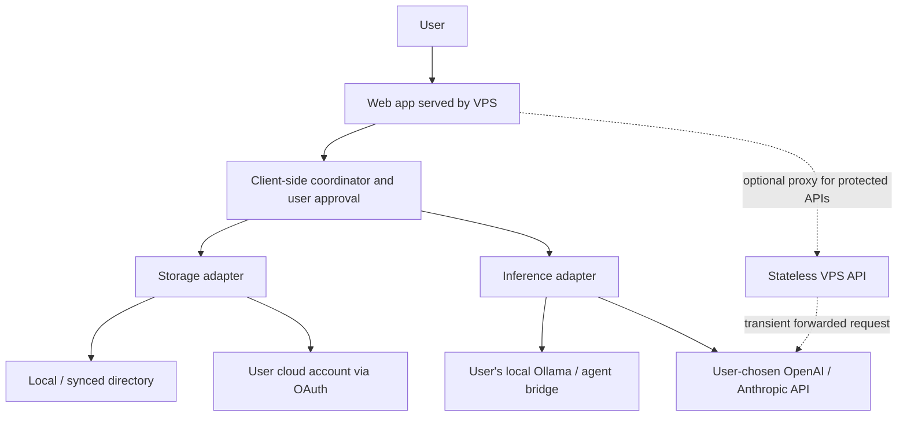

# Hybrid deployment and user-owned data

[Français](hybrid-architecture.fr.md) · [English](hybrid-architecture.md)

> **Concept / design exploration — not implemented.** This document describes a target design, conditional integrations, and known limitations.

## Product decision

ReStart AI is **hybrid-first, provider-agnostic, and user-data-owned**. The user independently selects (1) where the data lives, and (2) where AI inference runs. No GPU or paid API is mandatory for every usage path, though each mode has its own constraints.

### Two independent choices

**AI engine**
- Local: Ollama or another compatible inference server, with a local agent runtime when needed.
- Remote: user-selected APIs such as OpenAI or Anthropic, with their own API account, billing and data processing terms.
- Hybrid: choose a provider per operation. A remote agent can be integrated through a documented capability and permission adapter; an LLM API alone does not constitute a fully operational agent.

**Storage**
- Local: user-selected directory (Markdown and related files).
- Synced directory: a directory synchronized by a desktop client to iCloud Drive, OneDrive, Dropbox, Google Drive or another service; on-device access depends on browser capabilities and OS permissions.
- Direct cloud provider: user-authorized API integration (e.g., Google Drive, Microsoft Graph OneDrive, Dropbox).
- Other storage adapters may be explored, such as WebDAV or S3-compatible accounts personally controlled by the user.

Users can mix choices, e.g. **local files + Anthropic API**, **OneDrive + local Ollama**, or **Dropbox + OpenAI API**.

## Hosting and trust boundaries

A public VPS may host:
- Static web front end and application assets.
- Python API for *stateless* orchestration, capability discovery, provider metadata and optional secure request proxying.
- No persistent user CV, application, interview, or profile database.

**Important qualification:** an HTTP server that processes a request inevitably receives the information included in that request. "No VPS storage" is not "no VPS access" and not "end-to-end encryption." Cloud inference itself sends selected prompts to the chosen AI provider. Design aims to keep sensitive data in the browser/device when possible and to minimize any transiting payload. Reverse proxies, logs, error monitoring, caching and crash reports must not capture sensitive content. A VPS cannot execute browser-side local file operations or continue offline after the user's browser closes unless there is a separate user-controlled runtime or authorized remote infrastructure.

### Proposed paths



Prefer client-side coordination for direct user-data access. Optional stateless server-side orchestration requires narrow, explicit data forwarding and cannot read arbitrary local folders. Use a separately installed local companion for dependable local model connections, background jobs and cross-browser filesystem access if needed.

## Browser and cloud constraints

- **Browser local directory:** File System Access API (e.g., `showDirectoryPicker`) requires HTTPS, user interaction and permission; browser support is incomplete. Provide imports/exports or a user-side companion fallback.
- **iCloud Drive:** not equivalent to a generic browser-accessible REST file drive. A user-selected local iCloud-synced directory may work where browser/OS access is available; a native desktop connector would offer stronger compatibility. Do not promise universal direct iCloud web access.
- **Google Drive:** standard visible folders may be more suitable for human-readable Markdown than the hidden `appDataFolder`.
- **OneDrive and Dropbox:** application-folder permissions can reduce scope. Validate provider limitations, OAuth consent and account compatibility.
- **Local LLM:** direct HTTPS browser access to localhost or LAN requires explicit endpoint permission and security review (CORS, mixed content, private-network restrictions, authentication and CSRF/SSRF risks). Never expose Ollama unrestricted to the Internet.
- **Cloud LLM:** browser-exposed API keys are a security risk. Evaluate a user-controlled local bridge or short-lived credentials / tightly scoped stateless proxy when supported; avoid storing BYOK secrets on the VPS. Public proxies need abuse prevention and rate limits.
- **Background jobs:** a browser-only design cannot guarantee scheduled searches while closed. Optional desktop companion or a separately consented remote scheduler is a later design choice; any remote scheduler may need scoped tokens and see user data.

## Markdown-first storage

Use **one Markdown file per professional profile, job opportunity, application and activity note**, with YAML front matter for stable identifiers and metadata. Store attachments and document exports in separate folders. This is a *proposal*, not an adopted stable schema.

```text
ReStartAI/
  profile/
    master-profile.md
  opportunities/
    job-example-001.md
  applications/
    application-example-001.md
  notes/
    career-plan.md
  attachments/
    .gitkeep
  exports/
    .gitkeep
```

Illustrative application record (fictional example):

```markdown
---
schema_version: 1
id: app-demo-001
type: application
job_ref: job-example-001
status: draft
created_at: 2026-11-07T00:00:00Z
updated_at: 2026-11-07T00:00:00Z
---

# Application notes

Documents pending user review. No application has been sent.
```

Files must remain editable without the app. A storage adapter defines read/write/list/version capabilities; use atomic writes where possible and handle concurrent editing, sync conflicts and backups. Markdown is the portable source of truth; an optional on-device search index is rebuildable and must not be the only source. Do not place secrets, access tokens or arbitrary private data in the repository.

## Security and privacy contract

1. Clearly show the current **storage provider** and **AI provider** separately.
2. Disclose where each request and document travels and where it may be retained.
3. Default to no external data transmission until necessary permissions are granted.
4. Obtain separate user approval for email sending, applications, shared changes and export.
5. Prefer OAuth Authorization Code with PKCE for browser connections; minimal scopes and revocation.
6. Treat job ads, documents and external model outputs as untrusted content; validate agent tool actions.
7. Prevent sensitive request bodies, document contents, OAuth codes and API keys from entering server logs.
8. Support portability, deletion, consent revocation and eventually optional client-side encryption; explain that encryption can restrict search and AI operations.
9. Do not claim zero provider-side retention; OpenAI and Anthropic APIs have endpoint- and account-dependent policies.

## Feasibility / validation tasks

1. Prove local Markdown save/load on supported Chromium browsers and fallback import/export on Safari/Firefox.
2. Prove one cloud storage adapter with minimal OAuth permissions and inspect token handling.
3. Prototype one Ollama adapter plus one cloud inference adapter using fictional data only.
4. Measure data flowing through VPS, browser, cloud storage and inference provider; audit logs.
5. Test conflicts when two devices edit the same Markdown file.
6. Document offline behavior and limits of scheduled tasks.

## Reference documentation
- [MDN: showDirectoryPicker](https://developer.mozilla.org/en-US/docs/Web/API/Window/showDirectoryPicker)
- [Google Drive: appDataFolder](https://developers.google.com/workspace/drive/api/guides/appdata)
- [Microsoft Graph: OneDrive app folders](https://learn.microsoft.com/en-us/graph/onedrive-sharepoint-appfolder)
- [Dropbox API: application folders](https://docs.dropboxapi.com/dropbox-api/docs/get-started/quick-start)
- [OpenAI API: data controls](https://developers.openai.com/api/docs/guides/your-data)
- [Anthropic API: retention](https://platform.claude.com/docs/en/build-with-claude/api-and-data-retention)
